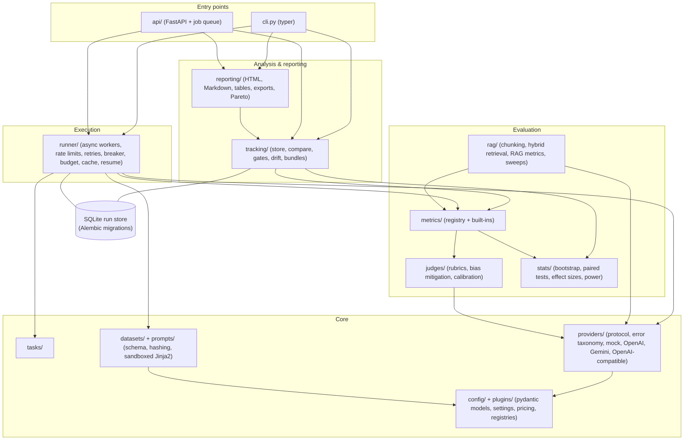
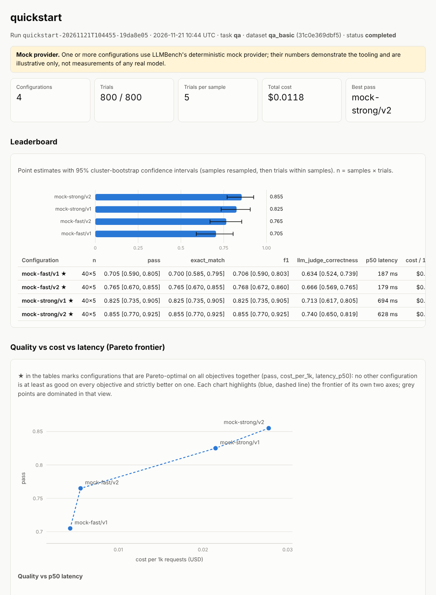

# LLMBench

**Reproducible evaluation, benchmarking and regression testing for non-deterministic LLM and RAG systems: repeated trials, real statistics, and a CI gate that fails only on regressions you can trust.**

[](https://github.com/PiyushDas-2004/LLMBench/actions/workflows/ci.yml)
[](https://github.com/PiyushDas-2004/LLMBench/actions/workflows/eval-gate.yml)


[](LICENSE)

## Why this exists

Send the same prompt to the same model twice and you can get two different answers.
Teams still change a model, a prompt or a retrieval setting, look at a handful of outputs,
and decide it "seems better". LLMBench turns that into a measurement. It runs every
(model, prompt, sample) combination several times, scores quality, consistency, failure
rate, latency and cost, and stores every trial. Then it tells you, with confidence
intervals, a named test and an effect size, whether a change is a real improvement, a
real regression, or noise.

It runs fully offline with a deterministic mock provider (no API keys needed), and the
same configs run unchanged against OpenAI, Gemini or any OpenAI-compatible server
(Ollama, vLLM, LM Studio).

## Features

- **Experiments as YAML**: models × prompts × samples × repeated trials, validated with
  pydantic. `llmbench plan` prints the grid size and an upper-bound token and cost estimate.
  Runs that exceed a cost threshold need `--yes`.
- **Robust async runner**: bounded concurrency; per-endpoint token buckets for
  requests/min and tokens/min; full-jitter retries that honour `Retry-After`; retries only
  for transient error classes; a circuit breaker with a half-open probe; budget guards that
  stop gracefully; and per-trial checkpointing with `llmbench resume`. A content-addressed
  response cache is keyed by trial index, so repeated trials stay independent.
- **Typed failure taxonomy**: `TIMEOUT`, `RATE_LIMITED`, `AUTH`, `SERVER_ERROR`,
  `INVALID_REQUEST`, `CONTENT_FILTERED`, `REFUSAL`, `MALFORMED_OUTPUT`, `NETWORK`.
- **Metrics, all with per-sample values** (registry with plugins):
  - lexical: exact match, F1, ROUGE-L, regex, length, language
  - structural: JSON validity, JSON Schema, field accuracy
  - semantic similarity
  - **consistency across trials**: agreement with the modal answer, semantic consistency,
    answer entropy, unbiased pass@k and pass^k, flip rate
  - reliability, latency (p50–p99, TTFT, tokens/s), cost (per 1k requests, per correct
    answer, quality per dollar)
  - safety: injection resistance, canary leakage, over-refusal
- **LLM-as-a-judge done properly**: YAML rubrics with anchors, JSON-schema validation with
  a repair loop, and self-consistency. Pairwise judging swaps answer order and flags
  disagreement. Reports length bias and warns when the judge model is also a candidate.
  **Calibrates against human labels** (accuracy, Cohen's κ, confusion matrix). Every judge
  call is stored for audit.
- **RAG evaluation**: a pluggable `Retriever` interface and a reference pipeline with
  chunking, BM25 + vector hybrid retrieval with reciprocal rank fusion, LLM reranking and
  cited answers. Metrics:
  - retrieval: context precision and recall, hit@k, MRR, nDCG@k
  - generation: claim-level faithfulness, hallucination, citation accuracy, abstention on
  unanswerable questions

  Configuration **sweeps** report which setting moves which metric. pgvector is optional.
- **Statistics you can defend**:
  - confidence intervals: percentile, BCa and **two-stage cluster bootstrap** (samples,
    then trials, because trials of one sample are correlated)
  - paired tests: permutation, bootstrap, McNemar and Wilcoxon
  - effect sizes: Cohen's d / d_z and Cliff's δ
  - multiple-comparison correction: Holm and Benjamini-Hochberg
  - minimum detectable effect, with a warning when the sample is too small
- **Tracking and gates**: runs are stored in SQLite via SQLAlchemy and Alembic, each with a
  full reproducibility manifest. `compare` shows aligned per-sample regressions with
  outputs side by side. **`check` is a CI gate**: it exits non-zero only when a gated metric
  drops beyond tolerance *and* the drop is significant. Drift detection catches silent
  provider-side changes.
- **Reports**: rich CLI tables; a self-contained HTML report (Pareto frontier, consistency,
  latency, failures, judge calibration, manifest; no network requests); Markdown for PR
  comments; JSON, CSV and Parquet exports.
- **Service and ops**:
  - FastAPI service: submit runs, poll progress, fetch results, compare; API-key auth,
    request IDs, Prometheus `/metrics`
  - observability: structlog JSON logs with secret redaction; optional OpenTelemetry spans
  - Docker image (non-root, multi-stage) and docker-compose
- **Quality bar**: `mypy --strict`, ruff, bandit and pip-audit are clean; 221 offline tests,
  including property-based tests of the statistics; 96% coverage.

## Architecture



Core modules never import provider SDKs; only the adapters do (enforced by a ruff
`TID251` rule). Details: [docs/ARCHITECTURE.md](docs/ARCHITECTURE.md) and the
[architecture decision records](docs/adr/README.md).

## 5-minute quickstart (no API keys)

Requires Python 3.11+ and git.

```bash
git clone https://github.com/PiyushDas-2004/LLMBench.git
cd LLMBench
python -m venv .venv && source .venv/bin/activate
pip install -e .

llmbench plan examples/quickstart.yaml      # grid size and cost estimate
llmbench run examples/quickstart.yaml       # 800 trials against the mock provider (a few seconds)
llmbench report latest                      # writes reports/<run-id>.html
llmbench compare latest latest --pair mock-fast/v2=mock-strong/v2
```

The quickstart compares two simulated models × two prompt versions × 40 questions × 5
trials. `llmbench run` ends with a leaderboard. This is real output, but it comes from the
**mock provider, so the numbers are illustrative only** (generated 2026-11-21):

```text
                                        quickstart (quickstart-20261121T110737-86384b15)
┏━━━━━━━━━━━━━━━━━━┳━━━━━━┳━━━━━━━━━━━━━━━━━━━━┳━━━━━━━━━━━━━━━━━━━━┳━━━━━━━━━━━━━━━━━━━┳━━━━━━━━━━━┳━━━━━━━┳━━━━━━━━┳━━━━━━━━━┓
┃ configuration    ┃    n ┃               pass ┃                 f1 ┃             judge ┃ agreement ┃ p50 … ┃ fail % ┃ $/1k r… ┃
┡━━━━━━━━━━━━━━━━━━╇━━━━━━╇━━━━━━━━━━━━━━━━━━━━╇━━━━━━━━━━━━━━━━━━━━╇━━━━━━━━━━━━━━━━━━━╇━━━━━━━━━━━╇━━━━━━━╇━━━━━━━━╇━━━━━━━━━┩
│ mock-fast/v1 *   │ 40x5 │ 0.705 [0.59, 0.81] │ 0.706 [0.59, 0.80] │ 0.634 [0.52, 0.7… │     0.665 │   187 │    0.0 │  0.0043 │
│ mock-fast/v2 *   │ 40x5 │ 0.765 [0.67, 0.86] │ 0.768 [0.67, 0.86] │ 0.666 [0.57, 0.7… │     0.665 │   179 │    0.0 │  0.0055 │
│ mock-strong/v1 * │ 40x5 │ 0.825 [0.73, 0.91] │ 0.825 [0.73, 0.91] │ 0.713 [0.62, 0.8… │     0.710 │   694 │    0.0 │  0.0215 │
│ mock-strong/v2 * │ 40x5 │ 0.855 [0.77, 0.93] │ 0.855 [0.77, 0.93] │ 0.740 [0.65, 0.8… │     0.720 │   628 │    0.0 │  0.0278 │
└──────────────────┴──────┴────────────────────┴────────────────────┴───────────────────┴───────────┴───────┴────────┴─────────┘
                                 estimate [95% CI]; * = Pareto-optimal (quality, cost, latency)
```

`compare` (Markdown via `--format md`) answers the question you would otherwise
eyeball. Below, a 9-point pass-rate gap on 40 questions is **not** statistically
significant, while the latency difference is:

| metric | baseline | candidate | delta [95% CI] | test | p (adj.) | effect size | n | verdict |
|---|---:|---:|---:|---|---:|---:|---:|---|
| pass | 0.765 | 0.855 | +0.090 [-0.015, +0.190] | paired-permutation | 0.335 | cliffs_delta=0.20 | 40 x 5 | no significant change |
| llm_judge_correctness | 0.666 | 0.740 | +0.074 [-0.030, +0.173] | paired-permutation | 0.343 | cohens_dz=0.22 | 40 x 5 | no significant change |
| exact_agreement | 0.665 | 0.720 | +0.055 [-0.050, +0.150] | paired-permutation | 0.343 | cohens_dz=0.18 | 40 x 1 | no significant change |
| latency_ms | 187.518 | 675.467 | +487.949 [+448.094, +530.702] | paired-permutation | <0.001 | cohens_dz=3.66 | 40 x 5 | **regressed** |

More generated output (pairwise comparisons, the safety suite, a 96-setting RAG sweep,
judge calibration) is in [docs/example-report/](docs/example-report/README.md), with the
command that produced each file.

### Sample HTML report



The full self-contained report is
[docs/example-report/quickstart.html](docs/example-report/quickstart.html). Its sections:
leaderboard with CIs, quality vs cost vs latency with the Pareto frontier, consistency
across trials, latency distributions, failure breakdown and cost efficiency, per-tag
breakdown, worst-failing samples with outputs, judge calibration (Cohen's κ against
human labels) and the full run manifest.

**No real-provider numbers are published in this repository.** The environment that
produced it had no API keys. To produce a real report, export `OPENAI_API_KEY` and/or
`GEMINI_API_KEY`, fill in the `"<set me>"` model names in
[examples/experiment.yaml](examples/experiment.yaml), and run it. Models whose keys are
missing are skipped with a warning.

## Using it in CI: the eval gate

```bash
llmbench baseline set <run-id> --name main          # or: llmbench import baselines/main.json --as-baseline main
llmbench run examples/gate/regression.yaml
llmbench check --baseline main --gates examples/gates.yaml --output gate.md
echo $?                                             # 0 = pass, 1 = regression, 2 = configuration error
```

Real output on the seeded regression from this repository's
[eval-gate workflow](.github/workflows/eval-gate.yml) (mock provider):

```text
                                                       Eval gate: FAILED
┏━━━━━━━━━━━━┳━━━━━━━━━━━━━━━┳━━━━━━━━┳━━━━━━━━━━━━━━━━━━━━━━━━━━━━━━━━━━━━━━━━━━━━━━━━━━━━━━━━━━━━━━━━━━━━━━━━━━━━━━━━━━━━━━━━┓
┃ gate       ┃ configuration ┃ result ┃ reason                                                                                ┃
┡━━━━━━━━━━━━╇━━━━━━━━━━━━━━━╇━━━━━━━━╇━━━━━━━━━━━━━━━━━━━━━━━━━━━━━━━━━━━━━━━━━━━━━━━━━━━━━━━━━━━━━━━━━━━━━━━━━━━━━━━━━━━━━━━┩
│ pass       │ assistant/v1  │ FAIL   │ regressed by 0.2417 (> max_drop 0.02); p_adj=0.0008999 < 0.05 with paired-permutation │
│ f1         │ assistant/v1  │ FAIL   │ regressed by 0.2375 (> max_drop 0.03); p_adj=0.0008999 < 0.05 with paired-permutation │
│ latency_ms │ assistant/v1  │ pass   │ change +5.1175 within tolerance                                                       │
└────────────┴───────────────┴────────┴───────────────────────────────────────────────────────────────────────────────────────┘
```

The same workflow re-runs the configuration with only new sampling noise and requires
the gate to **pass**. The test suite checks that the gate stays quiet across repeated
noise-only re-runs (false-positive rate ≈ α). Wiring the gate into another repository:
[docs/CI_EVAL_GATE.md](docs/CI_EVAL_GATE.md).

## CLI reference

| Command | What it does |
|---|---|
| `llmbench init [DIR]` | Scaffold a runnable example project (dataset, prompts, rubric, pricing, gates). |
| `llmbench validate CONFIG` | Validate config, dataset, prompts, metrics, judge rubric and pricing. |
| `llmbench plan CONFIG` | Grid size, token estimate and upper-bound cost; lists skipped models. |
| `llmbench run CONFIG [--yes] [--no-cache] [--tag k=v] [--strict-models] [--report out.html]` | Execute and checkpoint every trial; computes metrics; prints the leaderboard. Ctrl-C stops cleanly. |
| `llmbench resume RUN` | Continue an interrupted run (only missing trials; refuses if the dataset or prompts changed). |
| `llmbench rerun RUN` | Start a new run recreated from a stored manifest. |
| `llmbench list` / `show RUN` | Recent runs / leaderboard with CIs for one run. |
| `llmbench compare A B [--metric m] [--pair a/p=b/p] [--allow-dataset-drift] [--format table\|md\|json]` | Paired statistical comparison with per-sample regressions and tag breakdown. |
| `llmbench baseline set RUN --name main` / `baseline show` | Manage named baselines. |
| `llmbench check --baseline main --gates gates.yaml [--output gate.md]` | CI gate; exit 0 pass, 1 regression, 2 config error. |
| `llmbench drift --model M --prompt P [--metric pass]` | Rolling robust z-score and CUSUM drift check over runs. |
| `llmbench report RUN --format html\|md` | Self-contained HTML report or Markdown summary. |
| `llmbench export RUN --format json\|csv\|parquet` / `import BUNDLE` | Portable run bundles (JSON) and flat trial tables. |
| `llmbench judge calibrate LABELED.jsonl [--config EXP] [--attach RUN]` | Judge agreement with human labels (accuracy, κ, confusion matrix). |
| `llmbench rag sweep SWEEP.yaml [--output md] [--json out.json]` | Evaluate a grid of RAG settings with main-effects analysis. |
| `llmbench serve [--host --port] [--insecure-no-auth]` | Start the REST API. |
| `llmbench metrics` / `tasks` / `providers` | List registered plugins and provider readiness. |
| `llmbench cache clear` | Drop cached responses. |

Global options: `--db URL` (default `sqlite:///.llmbench/llmbench.db`, or `LLMBENCH_DB_URL`),
`--log-level`, `--log-format console|json`, `--version`.

## Configuration reference

```yaml
name: qa-model-comparison
dataset: ../datasets/qa_basic.jsonl      # JSONL/YAML; relative to this file, then the cwd
task: qa                                 # qa | classification | extraction | safety | rag | generic
trials: 5                                # repeated trials per (sample, model, prompt)
seed: 1234
concurrency: 8
sampling: {n: 20, seed: 0, stratify_by_tag: true}   # optional reproducible subsample
rate_limit: {requests_per_minute: 120, tokens_per_minute: 200000}   # per provider endpoint
budget: {max_usd: 5.00, max_requests: 5000}
retry: {max_attempts: 4, base_delay_s: 0.5, max_delay_s: 30, timeout_s: 60}
circuit_breaker: {failure_threshold: 8, reset_timeout_s: 30}
pricing: pricing.yaml                    # user-maintained, dated; never hardcoded
cost_confirm_threshold_usd: 1.0          # `run` needs --yes above this estimate
cache: true
models:
  - {id: gpt-main, provider: openai, model: "<set me>", params: {temperature: 0.7, max_tokens: 256}}
  - {id: gemini-main, provider: gemini, model: "<set me>", params: {temperature: 0.7, stream: true}}
  - {id: local-small, provider: openai_compat, model: "<set me>", base_url: "http://localhost:11434/v1"}
  - {id: mock, provider: mock, params: {accuracy: 0.8, failure_rate: 0.05, temperature: 0.7}}
prompts:
  - {id: v1, template: ../prompts/qa_v1.j2}
  - {id: v2, template: ../prompts/qa_v2.j2, system: "You are concise."}
metrics: [exact_match, f1, rouge_l, semantic_similarity, llm_judge_correctness, consistency, latency, cost]
judge: {provider: openai, model: "<set me>", rubric: ../rubrics/correctness.yaml, swap_order: true, samples: 1}
```

- `consistency`, `latency`, `cost`, `reliability` and `safety` are metric bundles. Metric
  params use `{name: json_schema, params: {schema: ../datasets/extraction_schema.json}}`.
- Model `params` hold generation parameters (`temperature`, `top_p`, `max_tokens`, `seed`,
  `stop`, `stream`, `json_mode`). For the mock they also hold its simulation knobs
  (`accuracy`, `failure_rate`, `error_mix`, `retry_after_s`, `refusal_rate`,
  `malformed_rate`, `injection_susceptibility`, `latency_ms`, `mock_seed`, ...), documented
  in [`providers/mock.py`](src/llmbench/providers/mock.py).
- Keys come only from the environment (`OPENAI_API_KEY`, `GEMINI_API_KEY`, or a model's
  `api_key_env`). See [.env.example](.env.example).
- Templates are sandboxed Jinja2 with variables `input`, `context`, `documents`, `tags`,
  `metadata` and `sample_id`. The reference answer is deliberately not available to them.

## Extending LLMBench

**A new metric in under 15 lines**:

```python
from llmbench.metrics import trial_metric


@trial_metric("cites_source", kind="binary", description="Answer cites a [n] source.")
def cites_source(trial, sample):
    return float("[" in trial.output_text and "]" in trial.output_text)
```

Save it as `my_metrics.py` next to your experiment and run with
`LLMBENCH_PLUGINS=my_metrics llmbench run experiment.yaml` (or expose it through the
`llmbench.metrics` entry-point group in your package's `pyproject.toml`). Add
`cites_source` to `metrics:` and it appears in reports, comparisons and gates. For metrics over all trials
of a sample, subclass `GroupMetric`.

**A new provider** implements the async `Provider` protocol (`generate`, `embed`,
`aclose`). It raises `ProviderError(ErrorClass.X, ...)` on failure and registers a factory:

```python
from llmbench.providers import PROVIDERS, GenerationResult

class EchoProvider:
    name = "echo"
    async def generate(self, request):
        return GenerationResult(text=request.messages[-1].content, provider=self.name, model=request.model)
    async def embed(self, texts, model=None):
        raise NotImplementedError
    async def aclose(self):
        pass

PROVIDERS.register("echo", lambda spec, settings: EchoProvider())
```

Load it the same way (`LLMBENCH_PLUGINS=my_provider`) and use `provider: echo` in a model.

Task types (parsing plus pass criterion) register the same way via `llmbench.tasks`.

## More guides

- [docs/METHODOLOGY.md](docs/METHODOLOGY.md): every metric and statistical method, with
  formulas, assumptions and limitations.
- [docs/RAG_EVALUATION.md](docs/RAG_EVALUATION.md): benchmarking your own retriever, the
  reference pipeline, RAG metrics and sweeps (`llmbench rag sweep examples/rag_sweep.yaml`).
- [docs/CI_EVAL_GATE.md](docs/CI_EVAL_GATE.md): gate configuration, stored baselines,
  GitHub Actions and GitLab examples.
- [docs/ARCHITECTURE.md](docs/ARCHITECTURE.md) and [docs/adr/](docs/adr/README.md):
  design and decisions.

## REST API and Docker

```bash
export LLMBENCH_API_KEY=$(python -c "import secrets; print(secrets.token_hex(16))")
docker compose up --build                       # API on http://localhost:8000 (OpenAPI at /docs)
curl -s localhost:8000/health
curl -s -H "X-API-Key: $LLMBENCH_API_KEY" localhost:8000/runs
docker compose run --rm bench run examples/quickstart.yaml --yes   # benchmark inside the container
```

Endpoints: `POST /runs`, `GET /runs`, `GET /runs/{id}` (job or run status), `GET
/runs/{id}/results`, `POST /compare`, `GET /jobs`, `GET /health`, `GET /metrics`
(Prometheus). Submitted configs may only reference relative paths inside the server
workspace. Runs execute on an in-process worker pool; ARCHITECTURE.md describes moving
to a real queue.

## Limitations and honest caveats

- **Mock numbers are not model numbers.** The mock exists so everything is testable
  offline. Its `accuracy` knob is a target on a logit scale with per-sample difficulty,
  so observed pass rates differ from the nominal value.
- **Small datasets give wide intervals.** The shipped datasets have 25–40 items. As the
  comparison above shows, a 9-point gap can be inconclusive. Every comparison reports the
  minimum detectable effect, so you can see when a benchmark is too small to decide.
- **Heuristics are heuristics.** Refusal and abstention detection use phrase matching, the
  language check uses stop words, and the default `LexicalVerifier` for RAG faithfulness
  checks word overlap, not entailment. Use a calibrated judge for serious work.
- **The default embedder is lexical.** The offline `HashEmbedder` measures word overlap;
  set `embedder: st:<model>` (needs `pip install 'llmbench[embeddings]'`) for real
  semantic similarity.
- **LLM judges are biased.** LLMBench measures and mitigates bias (position swap, length
  correlation, calibration, self-preference warning) but cannot remove it. The mock judge
  in the example reaches only Cohen's κ = 0.33 against the human labels, and calibration
  exists to expose exactly this.
- **Costs are only as good as your pricing table**, which you maintain with an `as_of`
  date. Judge calls and the RAG sweep bypass the runner's budget, rate limiter and retries.
- **Drift detection** assumes independent runs and a stable reference window. It can say
  that something shifted, not why.
- **Single-node by design.** SQLite plus an in-process job queue is ideal for laptops and CI.
  Multi-instance service deployments should point `LLMBENCH_DB_URL` at Postgres and swap
  the queue.

## Roadmap

- Pairwise (A/B) judge metric in runs, using the existing position-swap machinery.
- Route judge calls and RAG sweeps through the runner (rate limits, retries, budget, cache).
- Selecting pgvector, sentence-transformer and cross-encoder backends from the sweep YAML.
- Anthropic and Bedrock adapters, plus streaming TTFT for more providers.
- Hosted dashboard over the REST API and a Postgres-backed job queue.

## Development

```bash
uv sync                  # all extras + dev tools (or: pip install -e ".[all]" plus the tools in the Makefile)
make lint type test      # ruff, mypy --strict, pytest with the 85% coverage gate
make security            # bandit + pip-audit
pytest -m live -o addopts=""   # provider contract tests (need keys and LLMBENCH_LIVE_*_MODEL)
```

See [CONTRIBUTING.md](CONTRIBUTING.md), [SECURITY.md](SECURITY.md) and
[CHANGELOG.md](CHANGELOG.md).

## License

MIT © 2026 Piyush Pradeep Das. See [LICENSE](LICENSE).
