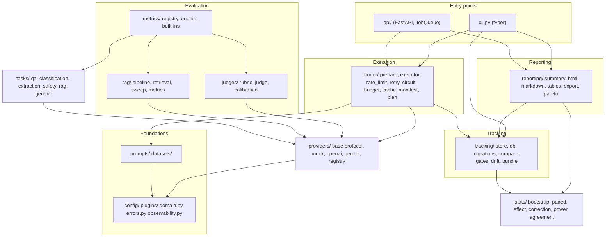
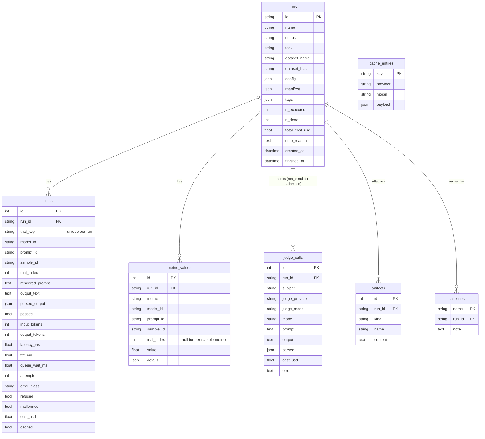

# LLMBench architecture

This document describes how LLMBench is put together: its layers, the path of one
`llmbench run`, the data model, what each module is responsible for, the invariants the code
relies on, and where it can be extended. Design rationale for individual decisions lives in
the [ADRs](adr/README.md); statistical definitions live in [METHODOLOGY.md](METHODOLOGY.md).
Module paths are relative to `src/llmbench/`.

## Purpose

LLMBench evaluates non-deterministic LLM and RAG systems reproducibly. An experiment is a grid
of models x prompts x dataset samples x repeated trials. LLMBench executes the grid against
providers under rate limits, retries and a budget, records every trial, computes metrics
(lexical, structural, semantic, consistency, operational, safety, RAG, LLM-judge), reports
per-configuration estimates with cluster-bootstrap confidence intervals, compares runs with
paired tests, and turns a comparison into a CI gate (`llmbench check`, see
[CI_EVAL_GATE.md](CI_EVAL_GATE.md)).

## Layers

Dependency direction is top to bottom. Entry points orchestrate; the lower layers know nothing
about the CLI or HTTP.



The layering is a guide, not a strict import rule. Known cross-links: the runner persists
through `tracking/store.py`; `metrics/engine.py` reads the store and loads pricing via
`runner/prepare.py`; `judges/factory.py` reuses `runner.prepare.load_pricing`;
`tracking/compare.py` asks the metric registry for each metric's direction and kind. The one
rule enforced by tooling is the provider-SDK boundary (see Invariants).

## Sequence of `llmbench run`

```mermaid
sequenceDiagram
    autonumber
    participant U as User
    participant C as cli.run / _execute
    participant P as runner.prepare
    participant R as Runner workers
    participant K as ResponseCache
    participant B as BudgetGuard
    participant L as CircuitBreaker + RateLimiter
    participant V as Provider
    participant S as RunStore
    participant E as metrics.engine.evaluate_run
    participant J as LLMJudge
    U->>C: llmbench run experiment.yaml
    C->>P: load_experiment + prepare (dataset, sampling, task, prompts, availability, pricing)
    C->>C: plan.estimate; exit 2 if over cost_confirm_threshold_usd without --yes
    C->>R: Runner.run(config) with SIGINT -> request_stop
    R->>S: create_run(manifest, dataset_hash, n_expected)
    loop each missing WorkItem (trial-major, `concurrency` workers)
        R->>K: get(provider, request, model params + base_url)
        alt cache hit
            K-->>R: GenerationResult (cached)
        else miss
            R->>B: reserve(estimated cost)
            loop attempts until success, non-retryable error or max_attempts
                R->>L: breaker.acquire, limiter.acquire(rpm, tpm)
                R->>V: generate(request) under wait_for(timeout_s)
                V-->>R: result or ProviderError(ErrorClass, Retry-After)
            end
            R->>B: settle(actual cost)
            R->>K: put (successful results only)
        end
        R->>S: add_trial(TrialRecord) checkpoint
    end
    R->>S: refresh_run_totals
    R->>E: evaluate_run(store, run_id)
    E->>S: trials, dataset hash check
    E->>J: pointwise judgments (if llm_judge_correctness)
    J->>S: add_judge_call (every call)
    E->>S: replace_metric_values
    R->>S: update_run(status, stop_reason)
    C->>S: summarize_run (cluster-bootstrap CIs, Pareto)
    C-->>U: summary table, optional --report HTML
```

Exit codes of `llmbench run`: 0 when the run completed or was interrupted (it prints the
resume command), 1 on a configuration or lookup error, 2 when the estimate exceeds
`cost_confirm_threshold_usd` without `--yes`, 3 when the run ended `budget_exceeded` or
`partial`.

## Data model

Tables are defined in `tracking/db.py` and created by the Alembic migration
`tracking/migrations/versions/0001_initial_schema.py` ([ADR 0001](adr/0001-sqlite-run-store.md)).



`metric_values` joins to `trials` logically on `(run_id, model_id, prompt_id, sample_id,
trial_index)`; there is no foreign key between them. `cache_entries` is shared across runs.
Run statuses are `running`, `completed`, `interrupted`, `budget_exceeded`, `partial` and
`failed`.

## Module responsibilities

| Module | Responsibility |
|---|---|
| `cli.py` | Typer commands: `init`, `validate`, `plan`, `run`, `resume`, `rerun`, `list`, `show`, `compare`, `export`, `import`, `report`, `baseline set/show`, `check`, `drift`, `judge calibrate`, `rag sweep`, `cache clear`, `serve`, `metrics`, `tasks`, `providers`. Installs the SIGINT handler and maps errors to exit codes. |
| `api/` | FastAPI app factory, in-process job queue, request/response schemas, Prometheus telemetry. |
| `config/` | Pydantic experiment schema (`models.py`), YAML loading with `ConfigError` (`loader.py`), environment settings (`settings.py`, `LLMBENCH_*`), pricing table (`pricing.py`). |
| `plugins/registry.py` | Generic `Registry[T]` with lazy entry-point discovery ([ADR 0006](adr/0006-plugin-system.md)). |
| `datasets/` | Sample schema, JSONL/YAML loading with duplicate-id checks, canonical content hashing, stratified sampling. |
| `prompts/template.py` | Jinja2 `SandboxedEnvironment` with `StrictUndefined`; templates may only use `input`, `context`, `documents`, `tags`, `metadata`, `sample_id`, so the reference answer can never leak into a prompt. Templates are content-hashed into the manifest. |
| `providers/` | `Provider` protocol, request/result types and `ErrorClass` taxonomy (`base.py`); mock ([ADR 0007](adr/0007-deterministic-mock-provider.md)); OpenAI / OpenAI-compatible and Gemini adapters ([ADR 0008](adr/0008-chat-completions-and-sdk-retries.md)); factory and availability checks (`registry.py`). |
| `tasks/base.py` | Task types defining parsing, the pass criterion, the mock oracle and default metrics. |
| `runner/` | `prepare.py` (validated, loaded experiment and lazy grid), `executor.py` (workers, retries, breaker, budget, checkpointing), `cache.py`, `manifest.py` (reproducibility record and run id), `plan.py` (pre-flight estimates) ([ADR 0002](adr/0002-async-runner.md), [ADR 0003](adr/0003-trial-level-cache-key.md)). |
| `metrics/` | Metric base classes and registry (`base.py`), bundles (`consistency`, `latency`, `cost`, `reliability`, `safety`), the evaluation engine (`engine.py`) that always adds `pass`, reliability, latency and cost metrics. |
| `judges/` | Rubrics, the LLM judge, the `llm_judge_correctness` metric and calibration ([ADR 0005](adr/0005-judge-bias-mitigation.md)). |
| `rag/` | Ingestion, chunking, BM25 / vector / hybrid retrieval, reranking, cited generation, RAG metrics and `rag sweep`. The sweep calls providers directly, without the runner's rate limiter, retries, cache or run store. |
| `stats/` | Bootstrap intervals, paired tests, effect sizes, multiple-comparison corrections, power and Cohen's kappa ([ADR 0004](adr/0004-bootstrap-design.md)). |
| `tracking/` | ORM models and migrations, `RunStore`, run comparison, regression gates, drift detection (rolling robust z-score and CUSUM), run bundles. |
| `reporting/` | `RunSummary` assembly, rich tables, self-contained HTML with inline SVG charts, Markdown for pull requests, CSV / Parquet / JSON export, Pareto front over quality, cost and latency. |
| `observability.py` | structlog configuration, redaction, optional OpenTelemetry spans. |
| `domain.py`, `errors.py`, `text.py`, `embeddings.py` | Shared records (`TrialRecord`, `MetricValue`), exception hierarchy rooted at `LLMBenchError`, text normalisation, deterministic hash embedder. |

## Key invariants

- **Core code never imports provider SDKs.** `pyproject.toml` bans `openai` and `google.genai`
  through ruff's `flake8-tidy-imports.banned-api` (rule TID251); only
  `providers/openai_provider.py`, `providers/gemini_provider.py` and the provider test files
  are exempt. The adapters import their SDK lazily and the registry imports the adapters inside
  the factories, so `pip install llmbench` without extras works with the mock provider.
- **Every test runs offline.** pytest's default `addopts` deselects `-m live`; real-API
  contract tests live in `tests/live/` and are skipped without keys. Adapter unit tests inject
  an `httpx2.MockTransport` client. Time-dependent runner logic uses `FakeClock`.
- **Reproducibility via manifests.** `runner/manifest.py` stores, per run: LLMBench version,
  Python and platform, git SHA, the full config and its hash, dataset path, full and evaluated
  content hashes and the evaluated sample ids, prompt template hashes, model specs, seeds, the
  pricing file and its `as_of` date, and the grid size. `rerun` re-creates a run from it;
  `resume` refuses when the evaluated dataset hash or a prompt template hash changed;
  comparisons refuse different
  dataset hashes unless `--allow-dataset-drift`.
- **The trial is the unit of persistence.** Each trial is committed as soon as it finishes;
  `trial_key` is unique per run.
- **No hardcoded models or prices.** Model names live in experiment YAML and prices in a
  user-supplied `pricing.yaml`; an unpriced model has `cost_usd = None`, not zero.
- **Secrets come from the environment only** (`Settings`, `SecretStr`), never from config files.

## Extension points

- **Providers**: register a factory `(ModelSpec, Settings) -> Provider` with
  `PROVIDERS.decorator(name)` or the `llmbench.providers` entry point; raise `ProviderError`
  with an `ErrorClass` so retries and the breaker apply.
- **Metrics**: subclass `TrialMetric` or `GroupMetric` with `@register_metric`, or decorate a
  function with `@trial_metric`; or publish under `llmbench.metrics`.
- **Tasks**: subclass `Task` and register an instance in `TASKS` or under `llmbench.tasks`.
- **Judge rubrics**: YAML files (criteria, scale, anchors) referenced from `judge.rubric`.
- **Gates**: `gates.yaml` per repository ([CI_EVAL_GATE.md](CI_EVAL_GATE.md)).
- **Storage**: any SQLAlchemy URL through `LLMBENCH_DB_URL` or `--db`.
- **RAG**: retrievers and rerankers follow the `Retriever` protocol in `rag/retrieval.py`;
  vector stores sit behind one interface in `rag/stores.py` (numpy by default, optional
  pgvector).

## API service

`llmbench serve` starts `api/app.py::create_app` under uvicorn (default bind `127.0.0.1:8000`).

- **Endpoints**: `POST /runs` (queue an experiment, 202 with a job id), `GET /runs`,
  `GET /jobs`, `GET /runs/{ref}` (job status, or stored run metadata by id, prefix, baseline
  name or `latest`), `GET /runs/{ref}/results` (full `RunSummary`), `POST /compare`,
  `GET /health`, `GET /metrics`.
- **Job queue** (`api/jobs.py`): an `asyncio.Queue` consumed by `LLMBENCH_API_WORKERS`
  (default 2) worker tasks in the server's event loop, each calling `Runner.run`. Job status
  lives in process memory; run results live in the database. To run several instances, replace
  `JobQueue` with an external queue (for example Arq on Redis, Celery or Cloud Tasks): the
  worker body stays `Runner(store, settings, evaluator=evaluate_run).run(config)` and all
  durable state is already in the shared database, which should then be Postgres rather than a
  SQLite file. On shutdown, workers are cancelled; trials already written stay in the store and
  the run can be continued with `llmbench resume`; the job is reported as `failed` with
  the reason "cancelled at server shutdown (resumable)".
- **Authentication**: every route except `/health`, `/metrics` and the OpenAPI pages requires
  an `X-API-Key` header equal to `LLMBENCH_API_KEY`, compared with `secrets.compare_digest`.
  `serve` refuses to start without the key unless `--insecure-no-auth` is passed.
- **Request ids**: a middleware takes `X-Request-ID` from the request or generates one, binds
  it into structlog context vars, echoes it in the response header and includes it in error
  bodies (`ErrorResponse`).
- **Prometheus metrics**: a private `CollectorRegistry` per app exposes
  `llmbench_http_requests` (method, route, status), `llmbench_http_request_duration_seconds`,
  `llmbench_runs` (by status), `llmbench_provider_requests` (model, cached),
  `llmbench_provider_errors` (model, error class) and `llmbench_provider_latency_seconds`.
  Provider counters are updated when a run finishes, from its stored trials.
- **Workspace sandboxing**: submitted configs are parsed with the workspace
  (`LLMBENCH_WORKSPACE`, default `.`) as base directory, and `validate_workspace_paths` rejects
  absolute paths or paths resolving outside it for `dataset`, `pricing`, `judge.rubric` and
  every prompt `template` / `system_template`. Symlinks are resolved before the check.
- **Errors**: `RunNotFoundError` maps to 404, other `LLMBenchError`s to 400.

## Observability

- **Logging** (`observability.py`): structlog to stderr, console or JSON
  (`LLMBENCH_LOG_FORMAT`, `--log-format`), with ISO UTC timestamps and context variables
  merged in. Runner events include `run_started`, `run_resumed`, `run_finished`; the judge
  factory logs `judge_unavailable` and `judge_is_candidate`.
- **Redaction**: a processor replaces fields whose names look like secrets (`api_key`,
  `secret`, `token`, `password`, `authorization`) and masks secret-shaped values inside strings
  (`sk-...`, `AIza...`, `Bearer ...`). With `LLMBENCH_REDACT_PROMPTS=true`, prompt and output
  fields are also replaced. Settings hold keys as `SecretStr`.
- **Tracing**: with `LLMBENCH_OTEL_ENABLED=true` and the `otel` extra installed, `span()` opens
  OpenTelemetry spans `llmbench.run` (run id, grid size), `llmbench.trial` (trial key, cache
  misses only) and `llmbench.provider_call` (provider, attempt). LLMBench only obtains a tracer;
  configuring a `TracerProvider` and exporter is left to the host process. Without the extra a
  warning is logged and spans become no-ops.
